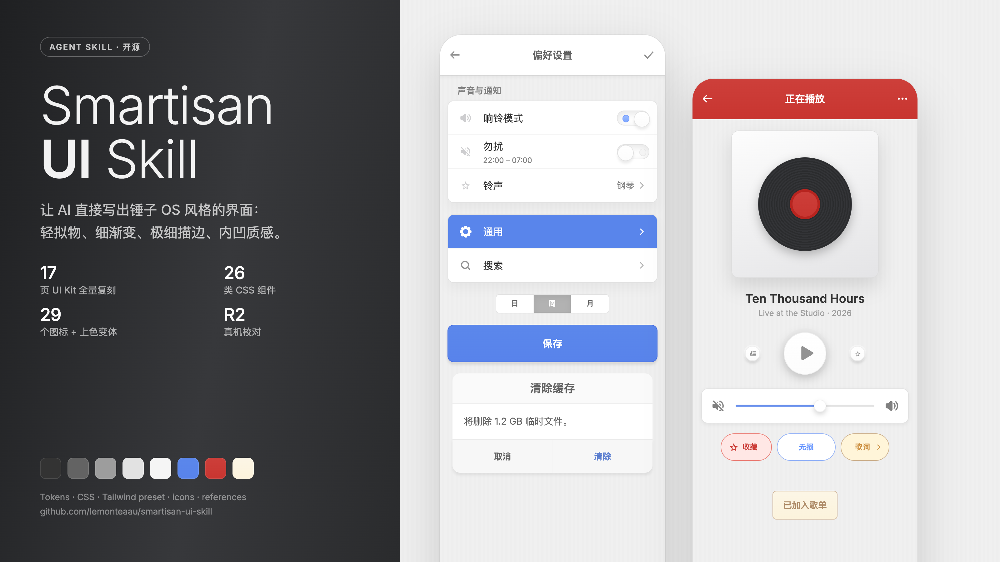
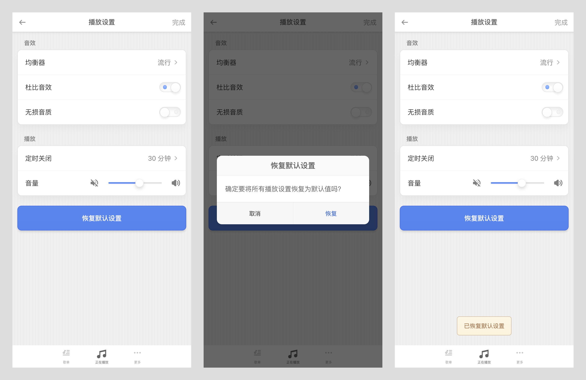
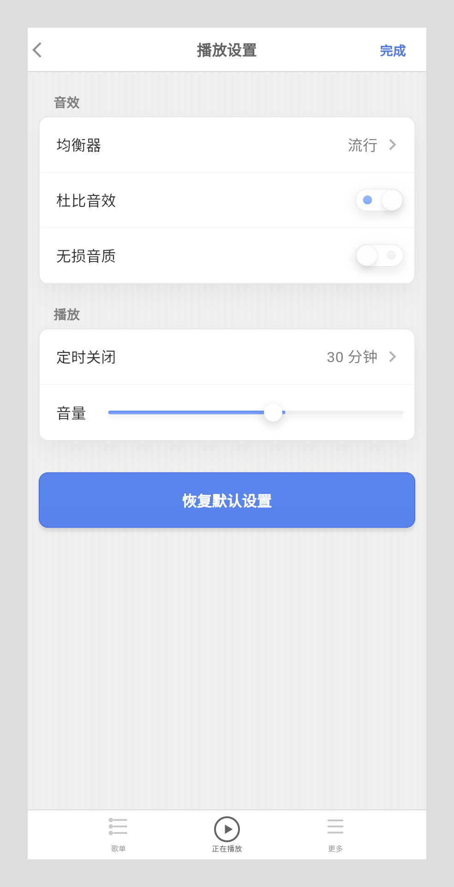

<p align="right"><a href="README.md">简体中文</a> | English</p>

# smartisan-ui

An Agent Skill that lets coding agents build UI in the style of **Smartisan OS** (the Smartisan / Nut phone OS). Works for web and Flutter.



## Install

**Any agent (recommended)** — with the [skills](https://github.com/vercel-labs/skills) CLI. It detects which agents you have installed and supports 50+ of them, including Claude Code, Codex, OpenCode, Cursor, Gemini CLI and GitHub Copilot.

```bash
npx skills add lemonteaau/smartisan-ui-skill
```

```bash
# only for specific agents, installed globally (-g)
npx skills add lemonteaau/smartisan-ui-skill -g -a claude-code -a codex -a opencode
```

**Claude Code plugin marketplace**

```bash
/plugin marketplace add lemonteaau/smartisan-ui-skill
/plugin install smartisan-ui@smartisan-ui-skill
```

**Manual** — clone into your agent's skills directory.

```bash
git clone https://github.com/lemonteaau/smartisan-ui-skill ~/.claude/skills/smartisan-ui
```

| Agent | Global | Project |
|---|---|---|
| Claude Code | `~/.claude/skills/` | `.claude/skills/` |
| Codex | `~/.codex/skills/` | `.agents/skills/` |
| OpenCode | `~/.config/opencode/skills/` | `.agents/skills/` or `.opencode/skills/` |
| Cursor | `~/.cursor/skills/` | `.agents/skills/` |
| Gemini CLI | `~/.gemini/skills/` | `.agents/skills/` |

## Usage

Just ask, e.g. "build a settings page in the Smartisan phone style" or "restyle this page like Smartisan OS". The agent loads the skill on its own.

## What's inside

- **The complete UI kit**: all 17 pages with every component, variant and state. Values are read from the Figma file and cross-checked on a real Smartisan R2.
- **Web**: `smartisan.css` (design tokens and 26 `.s-*` components), an optional `smartisan.js`, a Tailwind preset and `tokens.json`.
- **Flutter**: design tokens, 23 vector icons and a full widget set, with no third-party packages.
- **Icons**: 29 SVGs, plus the tinted variants used inside components.
- **References**: component specs, a Figma node inventory, reference screenshots of all 17 pages, and `demo.html`, a full replica of the kit.

## Showcase

Tested with [opencode](https://opencode.ai) + GLM-5.3.

<details>
<summary>Task prompt (Chinese)</summary>

```text
做一个音乐 App 的「播放设置」页面，要求做成锤子手机（Smartisan OS）的界面风格。
1. 顶部标题栏：左边返回，中间标题「播放设置」，右边一个完成按钮。
2. 「音效」设置列表：均衡器（显示「流行」带箭头）、杜比音效（开关，默认开）、无损音质（开关，默认关）。
3. 「播放」设置列表：定时关闭（显示「30 分钟」）、音量（滑块）。
4. 主按钮「恢复默认设置」，点击弹出确认对话框（取消 / 恢复），恢复后显示提示「已恢复默认设置」。
5. 底部导航：歌单、正在播放（当前页）、更多。
```
</details>

**Web** — page → confirm dialog → toast, done in about 3 minutes.



**Flutter** — same task: a 120-line `main.dart`, with zero `flutter analyze` issues.



## Credits & license

- Design source: [Smartisan OS UI Kit (Unofficial)](https://www.figma.com/community/file/1419385240874679870) by [Paix Chan](https://www.figma.com/@paixchan), licensed [CC BY 4.0](https://creativecommons.org/licenses/by/4.0/). Icons, component renders and reference screenshots come from that file and stay under CC BY 4.0.
- Code and docs written for this repo are [MIT](LICENSE).
- Smartisan, 锤子 and the T logo are trademarks of their owners. This is an unofficial fan project, not affiliated with Smartisan. The Smartisan Compact font is not included.
